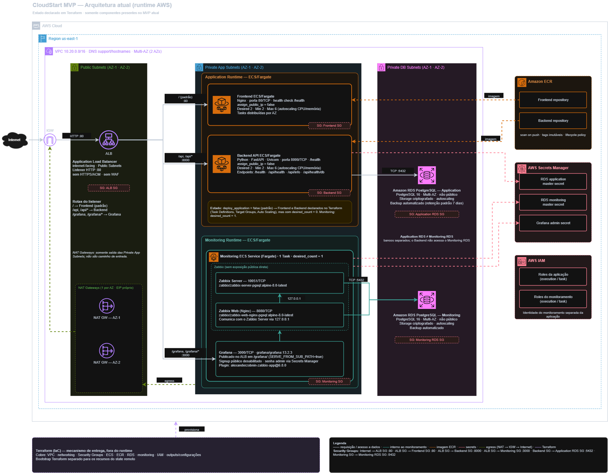

# CloudStart — AWS Application Infrastructure

[](https://developer.hashicorp.com/terraform)
[](https://aws.amazon.com/)
[](https://github.com/joao-henrike/NOVA/actions/workflows/ci.yml)
[](https://github.com/joao-henrike/NOVA/actions/workflows/deploy-dev.yml)

> **Current-state documentation:** this README describes the implementation contained in the `NOVA` repository and the current intended deployment behavior of the `Joao` branch. Planned P2/P3 capabilities are intentionally not presented as implemented architecture.
>
> **Important:** repository/IaC state and live AWS runtime state are different concepts. This README explicitly separates them whenever the distinction matters.

## 1. What this repository is

CloudStart is the AWS application-infrastructure baseline inside the NOVA repository.

The current implementation combines a small two-service web application with an AWS foundation built as Terraform and a dedicated monitoring runtime based on Zabbix and Grafana.

The current MVP contains:

* one custom VPC with dynamically discovered Availability Zones (two by default);
* public, private application, and private database subnets;
* one NAT Gateway per selected Availability Zone;
* one public Application Load Balancer, HTTP by default with an optional ACM-backed HTTPS mode;
* one ECS cluster using Fargate services;
* one frontend service, one backend service, and one monitoring service;
* two private ECR repositories;
* one private PostgreSQL RDS instance for the application and one separate private PostgreSQL RDS instance for Zabbix;
* Zabbix Server, Zabbix Web, and Grafana running in the monitoring ECS task;
* purpose-specific IAM execution roles and application task roles;
* RDS-managed master credentials plus separate runtime, migration, backend-authentication, and Grafana secrets;
* an S3 remote-state bootstrap with versioning, encryption, public-access blocking, ownership controls, secure-transport policy, and lifecycle configuration;
* root Terraform state locking with the S3 lockfile mechanism; the bootstrap also retains a DynamoDB compatibility table;
* GitHub Actions for CI, extreme validation, guarded development CD, and explicitly confirmed destructive development rebuild;
* local Docker Compose development for frontend, backend, and PostgreSQL.

The current MVP does **not** implement:

* financial core, double-entry ledger, payment orchestration, or reconciliation;
* mobile application, Audit Fabric, or Cost Intelligence / FinOps engine;
* enterprise hybrid integration, multi-account landing zone, or multi-region deployment;
* Kubernetes/EKS, service mesh, WAF, or managed ACM certificate issuance;
* enterprise Zero Trust or automated disaster-recovery environment.

Terraform can attach an already-issued ACM certificate to the ALB, but the committed development configuration leaves HTTPS disabled. Certificate issuance, domain validation, and DNS records remain operator-managed.

Future capabilities remain outside the current implementation boundary.

**Documentation map:** [Documentation index](docs/README.md) · [Deployment guide](docs/deployment.md) · [CI/CD](docs/ci-cd.md) · [Architecture](docs/architecture.md) · [Security model](docs/security.md) · [Accepted security exceptions](docs/security-exceptions.md) · [Current-state inventory](docs/current-state.md) · [Configuration reference](docs/configuration-reference.md) · [Local development](docs/local-development.md) · [Backend](apps/backend/README.md) · [Frontend](apps/frontend/README.md) · [Monitoring](monitoring/README.md) · [Bootstrap](bootstrap/README.md) · [Operational scripts](scripts/README.md).

## 2. Repository source of truth

The repository follows this model:

```text
GitHub
   |
   | branch: Joao
   v
Terraform / Application Code / Workflows
   |
   v
AWS
```

The primary working branch for this cycle is:

```text
Joao
```

Never use `main` as the direct implementation branch for these changes.

Before modifying anything:

```bash
git branch --show-current
git status --short --branch
```

Expected:

```text
Joao
```

---

## 3. Current implementation state

There are three states that must remain distinct.

| State               | Meaning                                                                           |
| ------------------- | --------------------------------------------------------------------------------- |
| Terraform/IaC       | What the repository declares Terraform should create/configure.                   |
| Container artifacts | What application images have been built and published to ECR.                     |
| AWS runtime         | What is actually running and healthy in the target AWS account at a given moment. |

A successful:

```bash
terraform apply
```

does **not** by itself prove that the application is healthy.

Likewise, a successful Docker build does not prove that the image is available in ECR or that ECS is running it.

The operational acceptance model is:

```text
IaC valid
+
Infrastructure provisioned
+
Images available
+
ECS tasks running
+
ALB targets healthy
+
Application endpoints healthy
+
RDS healthy
+
Monitoring healthy
+
Security reviewed
```

---

## 4. Current Joao branch deployment defaults

The repository keeps application workloads disabled by default. The development CD workflow enables them explicitly and replaces the Terraform default image tags with the full Git commit SHA.

Repository defaults:

```hcl
deploy_application = false
frontend_image_tag = "v0.1.1"
backend_image_tag  = "v0.1.0"
```

With deploy_application = false, frontend and backend desired/minimum task counts are evaluated as zero. When deployment is enabled, the configured capacity is:

```text
Frontend: min 2 / desired 2 / max 6
Backend:  min 2 / desired 2 / max 6
```

Target tracking defaults are CPU 60% and memory 70%. The validated utilization range is 20–90%.

The version tags above are Terraform defaults, not proof that those tags are currently deployed. Automated development releases use immutable full Git SHA tags. Temporary TF_VAR overrides used during recovery must not be treated as permanent repository configuration.

## 5. Application image tags

Terraform default tags are:

```text
Frontend: v0.1.1
Backend:  v0.1.0
```

These defaults preserve a known baseline in config/dev.tfvars. They do not identify the currently running ECS task revision.

The development CD and rebuild workflows build and publish images using an immutable full Git commit SHA. The deployed image must therefore be checked from the ECS task definition or the ECR repository; do not infer the live version from the Terraform defaults alone.

The frontend AWS Nginx configuration is separate from the local Compose configuration. The AWS image must not depend on the Compose-only DNS name backend:8000.

## 6. Architecture at a glance

```text
                           INTERNET
                              |
                              | HTTP :80
                              v
                    +----------------------+
                    | Application Load     |
                    | Balancer             |
                    +----------+-----------+
                               |
                +--------------+--------------+
                |                             |
              /api*                           /
                |                             |
                v                             v
       +------------------+          +------------------+
       | Backend ECS      |          | Frontend ECS     |
       | Fargate          |          | Fargate          |
       | :8000            |          | :80              |
       +--------+---------+          +------------------+
                |
                | TCP :5432
                v
       +----------------------+
       | Application RDS      |
       | PostgreSQL 16       |
       +----------------------+


                MONITORING PLANE

                    ALB /grafana/*
                         |
                         v
              +----------------------+
              | Monitoring ECS Task  |
              | Fargate              |
              |                      |
              | Zabbix Server        |
              | Zabbix Web           |
              | Grafana              |
              +----------+-----------+
                         |
                         | TCP :5432
                         v
              +----------------------+
              | Monitoring RDS       |
              | PostgreSQL 16       |
              +----------------------+
```



> The checked-in PNG is preserved unchanged from `main` as a visual reference. The Terraform and the detailed [architecture document](docs/architecture.md) remain authoritative if the diagram and current code ever differ.

Frontend, backend, and monitoring workloads run in private application subnets.

The Application Load Balancer and NAT Gateways are placed in public subnets.

RDS instances are placed in private database subnets.

---

## 7. Request flow

The current public HTTP entry point is the ALB.

```text
Client
  |
  | HTTP :80
  v
Application Load Balancer
  |
  +---- /api
  |       |
  |       v
  |   Backend Target Group
  |       |
  |       v
  |   Backend :8000
  |
  +---- /api/*
  |       |
  |       v
  |   Backend Target Group
  |
  +---- all other paths
  |       |
  |       v
  |   Frontend Target Group
  |       |
  |       v
  |   Frontend :80
  |
  +---- /grafana/*
          |
          v
      Grafana Target Group
          |
          v
       Grafana :3000
```

The ALB has a default action for the frontend.

A dedicated listener rule forwards:

```text
/api
/api/*
```

to the backend target group.

Grafana is exposed through:

```text
/grafana/
```

and:

```text
/grafana/*
```

---

## 8. Frontend AWS architecture

The frontend is an independent ECS/Fargate service.

Current production image:

```text
cloudstart-dev-frontend:v0.1.1
```

Current base image:

```text
nginx:1.29-alpine
```

The AWS production Nginx configuration is responsible for:

* serving the static application;
* SPA fallback and `/health` endpoint;
* no dependency on Docker Compose DNS names;
* serving local `app.js` and `styles.css` assets only (no inline JavaScript/CSS);
* enforcing a restrictive CSP, `nosniff`, anti-framing, no-referrer, and Permissions Policy headers.

The production image must **not** use:

```nginx
proxy_pass http://backend:8000;
```

because frontend and backend are separate ECS services.

The frontend browser calls:

```text
/api/health
```

and the ALB routes that request directly to the backend service.

### Frontend health

ECS has an explicit container health check against:

```text
/health
```

The ALB target group also checks:

```text
/health
```

---

## 9. Frontend local-development topology

Local Docker Compose uses a separate configuration:

```text
apps/frontend/nginx.local.conf
```

This configuration can resolve:

```text
backend
```

through Docker Compose service discovery.

Therefore:

```text
AWS:
Frontend -> browser -> ALB -> Backend

Local Compose:
Frontend container -> backend:8000
```

The two topologies are intentionally different.

This separation prevents AWS ECS from depending on a DNS name that only exists inside Docker Compose.

---

## 10. Backend architecture

The backend is an independent ECS/Fargate service.

Current production image:

```text
cloudstart-dev-backend:v0.1.0
```

Current base image:

```text
python:3.12-slim
```

The backend uses FastAPI and Uvicorn.

The current application exposes health/information endpoints including:

```text
GET /health
GET /api/health
GET /api/info
GET /api/health/db
```

The backend listens on:

```text
8000/TCP
```

### Backend container

The Dockerfile creates a dedicated non-root application user:

```text
appuser
UID 10001
```

The application code is owned by that user.

The ECS task definition contains an explicit container health check.

The ALB target group checks:

```text
/health
```

---

## 11. Backend database flow

The normal backend service receives:

```text
APP_ENV
DB_HOST
DB_PORT
DB_NAME
DB_USER=cloudstart_runtime
DB_PASSWORD (runtime secret)
```

It does not receive the RDS master password or the migration password. Its PostgreSQL grants are DML-only: SELECT, INSERT, UPDATE, DELETE, and sequence usage.

The one-off database migration task uses `cloudstart_migrator` and a separate Secrets Manager password. The one-off bootstrap task alone receives the RDS-managed master secret to create/update both roles and reapply grants after Alembic. The migration task and bootstrap task use separate ECS execution roles and intentionally omit `task_role_arn`, so neither process receives AWS task credentials. Their execution roles handle only image pulls, workload-specific logs, and startup-time secret injection; the running app task role has no Secrets Manager permission. Re-running bootstrap revokes database-level `PUBLIC CONNECT/TEMPORARY` and stale direct `TEMPORARY` grants, removes inherited role memberships, revokes stale direct and `PUBLIC` schema/table/sequence/function ACLs, transfers application routines to the migrator, and reapplies only runtime `CONNECT`, DML, and sequence usage/select privileges. The runtime login cannot create temporary tables; global and schema-specific default privileges for future tables, sequences and functions are also reconciled, so stale grants to `PUBLIC` or runtime cannot reappear after Alembic.

Database flow:

```text
Backend ECS
    |
    | TCP :5432
    v
Application RDS
```

The frontend never connects directly to RDS.

---

## 12. Network architecture

### 12.1 VPC

Default:

```text
Region:
us-east-1

VPC:
10.20.0.0/16
```

The VPC is dedicated to the CloudStart environment.

Availability Zones are discovered dynamically.

Default:

```text
2 AZs
```

The implementation requires sufficient AZ availability and derives subnets from the VPC CIDR.

---

## 13. Subnet model

The current network is divided into three tiers.

| Tier        | Purpose            | Internet routing          |
| ----------- | ------------------ | ------------------------- |
| Public      | ALB + NAT Gateways | Internet Gateway          |
| Private App | ECS workloads      | NAT Gateway               |
| Private DB  | RDS                | No default internet route |

Default CIDRs for two AZs:

```text
Public:
10.20.0.0/24
10.20.1.0/24

Private App:
10.20.10.0/24
10.20.11.0/24

Private DB:
10.20.20.0/24
10.20.21.0/24
```

---

## 14. Internet Gateway and NAT

The VPC has one Internet Gateway.

Public subnet routing:

```text
0.0.0.0/0
    |
    v
Internet Gateway
```

One NAT Gateway is created per selected AZ.

Private application routing follows:

```text
Private App AZ-A
       |
       v
NAT Gateway AZ-A
       |
       v
Internet Gateway

Private App AZ-B
       |
       v
NAT Gateway AZ-B
       |
       v
Internet Gateway
```

The database subnets intentionally do not receive a default route to the Internet.

This means the audit finding that claimed no NAT default routes existed was a false positive caused by the auditor's route parsing.

---

## 15. Security groups

The current network isolation uses dedicated security groups for:

```text
ALB
Frontend
Backend
One-off database tasks
Application RDS
Monitoring
Monitoring RDS
```

The important data path is:

```text
Internet
   |
   v
ALB
   |
   +----> Frontend
   |
   +----> Backend
             |
             v
        Application RDS
```

Monitoring follows:

```text
ALB
 |
 +----> Grafana
           |
Monitoring stack
           |
           v
      Monitoring RDS
```

RDS is not intended to be publicly accessible.

The audit correctly confirmed the current RDS instances as:

```text
PubliclyAccessible = false
```

---

## 16. Public ingress

The ALB is intentionally:

```text
internet-facing
```

and therefore a public ingress rule on the ALB security group is expected.

This is not itself a security defect.

The security requirement is that the public exposure terminate at the ALB rather than exposing:

```text
5432
8000
3000
10051
```

directly to the Internet.

---

## 17. HTTPS / ACM configuration

The committed development baseline leaves both optional variables empty, so it continues to expose HTTP on port 80:

```hcl
acm_certificate_arn = ""
alb_domain_name     = ""
```

Terraform now supports an optional HTTPS mode. To enable it, first obtain an **issued ACM certificate in the same AWS region as the ALB** and configure a hostname covered by that certificate:

```hcl
acm_certificate_arn = "arn:aws:acm:us-east-1:123456789012:certificate/00000000-0000-0000-0000-000000000000"
alb_domain_name     = "app.example.com"
```

Keep the real ARN and hostname in a protected environment-specific tfvars file when appropriate; do not copy the example ARN. The DNS provider must separately point the hostname to the ALB DNS name from the `alb_dns_name` output. This repository does not request ACM certificates, prove domain ownership, or create Route 53 records.

When both values are configured, Terraform creates an HTTPS listener on port 443 with the issued certificate, moves the application and Grafana listener rules to HTTPS, and changes port 80 into an HTTP 301 redirect that preserves the original host, path, and query. The ALB security group permits public 443 ingress only in this mode.

When both values are empty, the existing HTTP development listener remains active and no 443 ingress rule is created. The application is not TLS-protected until an operator supplies a valid certificate, hostname, and DNS record, then applies the reviewed plan.

For real Google and Apple sign-in, provider redirect URIs must use the same registered HTTPS hostname, for example:

```text
https://app.example.com/api/auth/google/callback
https://app.example.com/api/auth/apple/callback
```

Only verified email claims from the provider's signed ID token are used as account email. Apple's browser-posted profile object is used for an optional display name only; its email field is not trusted. Every `/api/*` response is marked `no-store` and includes `nosniff` and no-referrer headers, so user-specific item data is not cached by browsers or intermediaries.

---

## 18. ECS architecture

The cluster is:

```text
cloudstart-dev-cluster
```

Services:

```text
cloudstart-dev-frontend
cloudstart-dev-backend
cloudstart-dev-monitoring
```

Frontend and backend:

```text
Launch:
Fargate

Network:
awsvpc

Public IP:
disabled
```

The services use deployment protection:

```text
minimum healthy percent = 100
maximum percent = 200
health check grace = 60 seconds
circuit breaker = enabled
rollback = enabled
```

---

## 19. ECS task counts and autoscaling

When application deployment is enabled, the configured capacity is:

```text
Frontend: Desired 2 / Minimum 2 / Maximum 6
Backend:  Desired 2 / Minimum 2 / Maximum 6
```

When deploy_application = false (the committed repository baseline), Terraform evaluates frontend/backend desired and minimum counts as zero so infrastructure creation does not start the application workloads implicitly. The monitoring service remains at one task because the Zabbix server is stateful.

Autoscaling uses target tracking for CPU (60%) and memory (70%). Terraform deliberately ignores ECS desired_count changes after service creation so Application Auto Scaling can control runtime counts.

## 20. Monitoring architecture

The monitoring service runs as one stateful ECS service with desired count 1. Zabbix Server, Zabbix Web, and Grafana share one Fargate task and a dedicated private PostgreSQL RDS instance.

### Pinned monitoring images

```text
Zabbix Server: zabbix/zabbix-server-pgsql:alpine-7.4.15
Zabbix Web:    zabbix/zabbix-web-nginx-pgsql:alpine-7.4.15
Grafana:       grafana/grafana:13.2.3
Plugin:        alexanderzobnin-zabbix-app@6.8.0
```

The task is stateful because Zabbix Server runs inside it; the current configuration intentionally supports one task. The Terraform and local Compose configurations pin the same Zabbix and Grafana image versions.

Provisioning the containers does not automatically create Zabbix hosts, items, triggers, or Grafana dashboards. Those monitoring objects still need explicit configuration after the services are healthy.

## 21. Grafana

Grafana listens on:

```text
3000/TCP
```

Grafana is reached externally through:

```text
/grafana/
```

The monitoring stack uses the Zabbix Grafana plugin.

Current pinned plugin reference:

```text
alexanderzobnin-zabbix-app@6.8.0
```

Grafana is not intended to become a public standalone service.

Its public access path is:

```text
Internet
   |
   v
ALB
   |
   | /grafana/*
   v
Grafana Target Group
   |
   v
Monitoring Task
```

---

## 22. Monitoring runtime health status

The monitoring infrastructure is provisioned, but runtime health must be verified independently.

A previous audit observed:

```text
Grafana target:
unhealthy

Reason:
Target.Timeout
```

ECS also replaced monitoring tasks after unhealthy status.

Therefore monitoring must be considered:

```text
Provisioned
```

but not automatically:

```text
Healthy
```

until the following are confirmed:

```text
[ ] monitoring task running
[ ] Grafana process healthy
[ ] port 3000 reachable from ALB
[ ] Grafana target healthy
[ ] /grafana/ responds correctly
[ ] Zabbix Server stable
[ ] Zabbix Web stable
[ ] Monitoring RDS reachable
```

---

## 23. RDS architecture

Two independent PostgreSQL RDS instances exist.

### Application

```text
cloudstart-dev-db
```

### Monitoring

```text
cloudstart-dev-monitoring-db
```

Both are intended to remain private.

Current observed configuration:

```text
Engine:
PostgreSQL 16

PubliclyAccessible:
false

StorageEncrypted:
true

BackupRetention:
1 day

MultiAZ:
false
```

### Why Multi-AZ is false

The previous design used Multi-AZ, but the actual AWS account applied Free Tier restrictions that prevented the selected RDS configuration.

The environment is currently optimized for the observed Free Tier constraints rather than maximum production resilience.

This must not be documented as a fully resilient production RDS architecture.

---

## 24. RDS backup retention

Current repository defaults:

```text
Application RDS:
1 day

Monitoring RDS:
1 day
```

The previous value:

```text
7 days
```

caused:

```text
FreeTierRestrictionError
```

during instance creation.

The Terraform validation still permits the general RDS range:

```text
1–35 days
```

but the current environment uses:

```text
1 day
```

to remain compatible with the observed account restrictions.

---

## 25. RDS storage and access controls

The current database resources use:

```text
encrypted storage
private subnets
security-group isolation
RDS-managed master password
storage autoscaling
```

The application database is reachable from the backend security boundary.

The monitoring database is reachable from the monitoring security boundary.

All ECS task logs are centralized in CloudWatch Logs, separated by workload and retained for 7 days in development or 30 days in production.

RDS is not directly exposed through the public ALB.

---

## 26. Secrets Manager

The current application uses these secret classes:

| Secret | Owner / provisioner | Purpose |
| --- | --- | --- |
| RDS-managed master secret | AWS RDS | One-off database role-bootstrap task only. |
| cloudstart-dev/database/runtime | scripts/provision-db-credentials.sh | DML-only password for the normal backend task. |
| cloudstart-dev/database/migrator | scripts/provision-db-credentials.sh | Password for the one-off Alembic task. |
| cloudstart-dev/backend/authentication | scripts/provision-backend-auth-secret.sh | JWT signing key and optional Google/Apple OAuth configuration. |
| cloudstart-dev/monitoring/grafana-admin | Terraform | Grafana administrator password. |

The database and backend-auth provisioners generate or reuse Secrets Manager values. The backend-auth provisioner generates the JWT key only on first creation, preserves existing JWT material, and merges non-empty OAuth values supplied through local environment variables or the GitHub development Environment. It rejects incomplete provider configurations.

The local ignored files .deploy/db-secret-arns.env and .deploy/backend-auth-secret-arn.env contain ARNs only. The Grafana password used by local deployment is stored under .deploy/grafana-admin-password. Secret values must never be committed or printed into logs.

The canonical JSON keys and GitHub variables/secrets are listed in [Configuration reference](docs/configuration-reference.md).

Do not commit:

```text
terraform.tfvars
credentials
tokens
private keys
real passwords
Terraform state or plan files
```

Examples such as terraform.tfvars.example are documentation artifacts and are not themselves secrets.

## 27. ECR architecture

Repositories:

```text
cloudstart-dev-frontend
cloudstart-dev-backend
```

Both are private.

The current repositories use:

```text
image scanning on push
AES256 repository encryption
versioned image tags
lifecycle control
```

Current application artifacts:

```text
Frontend:
v0.1.1

Backend:
v0.1.0
```

---

## 28. ECR release process

Login:

```bash
aws ecr get-login-password --region us-east-1 | \
docker login \
  --username AWS \
  --password-stdin \
  760396521507.dkr.ecr.us-east-1.amazonaws.com
```

Build backend:

```bash
docker build \
  -t cloudstart-dev-backend:v0.1.0 \
  ./apps/backend
```

Build frontend:

```bash
docker build \
  -t cloudstart-dev-frontend:v0.1.1 \
  ./apps/frontend
```

Frontend validation:

```bash
docker run --rm \
  cloudstart-dev-frontend:v0.1.1 \
  nginx -t
```

Tag:

```bash
docker tag \
  cloudstart-dev-backend:v0.1.0 \
  760396521507.dkr.ecr.us-east-1.amazonaws.com/cloudstart-dev-backend:v0.1.0
```

```bash
docker tag \
  cloudstart-dev-frontend:v0.1.1 \
  760396521507.dkr.ecr.us-east-1.amazonaws.com/cloudstart-dev-frontend:v0.1.1
```

Push:

```bash
docker push \
  760396521507.dkr.ecr.us-east-1.amazonaws.com/cloudstart-dev-backend:v0.1.0
```

```bash
docker push \
  760396521507.dkr.ecr.us-east-1.amazonaws.com/cloudstart-dev-frontend:v0.1.1
```

Verify:

```bash
aws ecr describe-images \
  --repository-name cloudstart-dev-frontend \
  --region us-east-1 \
  --output table
```

```bash
aws ecr describe-images \
  --repository-name cloudstart-dev-backend \
  --region us-east-1 \
  --output table
```

---

## 29. Terraform structure

The root Terraform stack is intentionally split by responsibility.

```text
backend.tf
providers.tf
main.tf
locals.tf
variables.tf

vpc.tf
security_groups.tf

ecs.tf
ecs_services.tf

ecr.tf

rds.tf
monitoring.tf

iam.tf
outputs.tf
```

Bootstrap:

```text
bootstrap/
├── backend.tf
├── main.tf
├── outputs.tf
├── providers.tf
├── terraform.tfvars.example
└── variables.tf
```

---

## 30. Terraform remote state

The root backend uses S3 with:

```hcl
terraform {
  backend "s3" {
    key          = "cloudstart/dev/terraform.tfstate"
    encrypt      = true
    use_lockfile = true
  }
}
```

The committed development bucket is cloudstart-nova-terraform-state-760396521507. The bucket name and state key are also stored in config/dev.env; GitHub workflows allow the bucket to be overridden with the optional TF_STATE_BUCKET repository variable.

The root backend cannot reference normal Terraform input variables because backend configuration is initialized before variable evaluation. The normal deployment path invokes scripts/ensure-terraform-state.sh, which verifies the AWS account, expected bucket owner, and region; it reuses a matching bucket and creates bootstrap resources only when the bucket is genuinely missing. Access or ownership uncertainty causes a safe failure.

Manual initialization after the bucket is ready:

```bash
set -a
source config/dev.env
set +a
scripts/ensure-terraform-state.sh
terraform init \
  -backend-config="bucket=$TF_STATE_BUCKET" \
  -backend-config="region=$AWS_REGION" \
  -backend-config="key=$TF_STATE_KEY" \
  -reconfigure -input=false
```

Do not type shell commands into an interactive bucket prompt. If Terraform asks for a bucket name, stop and rerun init with explicit backend configuration.

## 31. Remote-state security

The bootstrap Terraform code configures the state bucket with:

```text
S3 versioning
SSE-S3 encryption
all four S3 public-access-block controls
BucketOwnerEnforced ownership
secure-transport deny bucket policy
noncurrent version lifecycle retention
incomplete multipart upload cleanup
```

These are declared controls in bootstrap/main.tf. This repository audit reviewed the configuration but did not query the live AWS bucket, so it does not certify the current runtime bucket settings.

The bootstrap stack itself uses local Terraform state. Protect and back up that state file; never commit it.

## 32. Bootstrap locking compatibility

The root Terraform backend uses S3-native locking through use_lockfile = true. The GitHub workflows initialize the backend with bucket, region, and state key; they do not pass a DynamoDB backend-lock argument.

The bootstrap stack still creates the DynamoDB table cloudstart-terraform-lock as a compatibility resource for older tooling. It is not the active lock mechanism for the current root backend. Do not describe the project as using DynamoDB locking, and do not add a dynamodb_table backend argument without an intentional architecture change.

## 33. IAM architecture

The current ECS identity model separates:

```text
ECS execution role
Frontend task role
Backend task role
Database bootstrap task: no task role
Database migration task: no task role
Monitoring execution role
Monitoring task role
```

The execution roles are responsible for actions such as:

```text
ECR image retrieval
Secrets Manager secret retrieval
```

Frontend and backend workloads receive separate task identities.

The intended principle is:

```text
Execution permissions
!=
Application permissions
```

and:

```text
Frontend task
!=
Backend task
```

The current repository now uses workload-specific ECS execution policies:

| Execution role | Intended permissions |
| --- | --- |
| Legacy `ecs_execution` | Frontend image pull and frontend logs; it retains conditional backend access only while `deploy_application = false` for the baseline task definition. |
| `ecs_backend_execution` | Backend image pull, backend log group writes, runtime DB secret, and backend authentication secret. |
| `ecs_migration_execution` | Backend image pull, migration log group writes, and the migrator DB secret. |
| `ecs_db_bootstrap_execution` | Backend image pull, bootstrap log group writes, and the RDS master plus runtime/migrator DB secrets required by the one-off bootstrap. |
| `ecs_monitoring_execution` | Monitoring log group writes, monitoring DB secret, and Grafana administrator secret. |

Frontend, backend, and monitoring task roles are separate from execution roles and have no additional application AWS permissions in the current implementation. The database bootstrap and Alembic task definitions omit `task_role_arn`, so their containers receive no ECS task-role credentials. The external GitHub OIDC deployment role is a separate control-plane identity and still requires operator-side trust-policy and least-privilege review. See [Security model](docs/security.md) and [CI/CD](docs/ci-cd.md).

---

## 34. GitHub Actions

The current workflow inventory is:

```text
.github/workflows/ci.yml
.github/workflows/extreme-validation.yml
.github/workflows/deploy-dev.yml
.github/workflows/rebuild-dev.yml
```

### Standard CI

ci.yml validates backend tests and migrations, frontend/backend image builds and runtime smoke, Compose configuration, Terraform formatting/validation, TFLint, Checkov, Trivy, Gitleaks, ShellCheck, CodeQL, and workflow contracts.

### Extreme validation

extreme-validation.yml runs the broader local/system checks and optional read-only AWS checks. It is restricted to pushes/manual dispatch on Joao because the optional AWS checks use GitHub OIDC; it does not run on pull requests.

### Development CD and rebuild

deploy-dev.yml performs guarded, non-destructive application delivery on Joao after CI. rebuild-dev.yml is manual-only and destructive; it requires the exact confirmation REBUILD. Production deployment automation is not present.

## 35. CI versus CD

The repository has both validation-oriented CI and a guarded development CD path.

Standard CI:

```text
Tests and migrations
Container build/runtime smoke
Compose validation
Terraform validation/lint
Security scans
Workflow contract checks
```

Development CD:

```text
Joao application/runtime-artifact change or manual dispatch
    -> wait for successful CI
    -> GitHub OIDC to the development AWS role
    -> build and scan frontend/backend images
    -> publish full Git-SHA tags to ECR
    -> ensure remote state and provision/reuse secrets
    -> create and guard a saved Terraform plan
    -> apply only the allowlisted development changes
    -> wait for ECS services
    -> DB bootstrap -> Alembic -> DB grants bootstrap
    -> ALB/API/database/Grafana smoke tests
```

Automatic CD is limited to development. The push path filter includes application source, migrations, Dockerfiles, relevant Nginx configuration, and docker-compose.yml; documentation, Terraform, scripts, and workflow changes alone do not trigger a push deployment. workflow_dispatch can run the development deploy workflow manually. The job requires AWS_CD_ROLE_ARN; TF_STATE_BUCKET has a committed default and is optional.

The manual rebuild workflow is separate and destructive. It requires confirmation=REBUILD and is never triggered by an ordinary push. There is no automatic production CD.

## 36. Local development

The main local application stack uses:

```text
docker-compose.yml
```

Application topology:

```text
Browser
   |
   | :8080
   v
Frontend / Nginx
   |
   | Docker service DNS
   v
Backend / FastAPI
   |
   | :5432
   v
PostgreSQL
```

The application Compose configuration uses a local-specific Nginx configuration:

```text
apps/frontend/nginx.local.conf
```

The AWS image uses:

```text
apps/frontend/nginx.conf
```

The two configurations must remain intentionally different.

---

## 37. Local monitoring

The monitoring stack is maintained separately from the application Compose stack.

Typical local monitoring services are:

```text
Grafana
Zabbix Server
Zabbix Web
Zabbix PostgreSQL
```

The local monitoring plane should not be confused with the AWS production-like monitoring ECS task.

---

## 38. Environment variables and secrets

For AWS Terraform operations, sensitive values may be supplied through environment variables.

Example:

```bash
export TF_VAR_grafana_admin_password='...'
```

Do not print the secret:

```bash
echo "$TF_VAR_grafana_admin_password"
```

Do not put real values into:

```text
terraform.tfvars.example
README.md
GitHub repository
Dockerfile
Docker image layers
audit reports
```

---

## 39. First-time operator setup

The supported first-time local setup is:

```bash
git clone --branch Joao --single-branch https://github.com/joao-henrike/NOVA.git
cd NOVA
make setup
make doctor
make validate
make up
make smoke
```

The bootstrap requires Git, curl, unzip, Python 3.12+, and a working Docker daemon. It installs the repository-pinned Terraform 1.16.4, TFLint 0.64.0, Buildx 0.17.0, Compose 5.6.0, and AWS CLI v2 only when the host does not already provide it. It creates .venv and installs backend runtime/development dependencies.

jq is required by the operational deployment scripts and is checked by make doctor, but is not installed by the local bootstrap. Checkov and pip-audit are CI-only tools and can be checked with CHECK_CI_TOOLS=1 after installing them separately.

The bootstrap does not authenticate to AWS, create credentials, or create billable AWS resources. See docs/local-development.md for the complete local workflow.

## 40. Terraform initialization from a new environment

For the development account, load the non-sensitive metadata and let the state helper verify or create the bucket:

```bash
set -a
source config/dev.env
set +a
scripts/ensure-terraform-state.sh
```

Then initialize the canonical root state:

```bash
terraform init \
  -backend-config="bucket=$TF_STATE_BUCKET" \
  -backend-config="region=$AWS_REGION" \
  -backend-config="key=$TF_STATE_KEY" \
  -reconfigure -input=false
```

For a custom environment, provide its bucket, region, and key explicitly. Do not assume the default account/bucket names are suitable for another AWS account.

Then validate and review:

```bash
terraform fmt -check -recursive
terraform validate
terraform plan -out=nova-start.tfplan
terraform show -no-color nova-start.tfplan
```

Only after reviewing the plan should an operator decide whether to apply it. make deploy performs its own guarded deployment sequence.

## 41. Safe Terraform operating procedure

For manual infrastructure changes:

```text
Change
  -> git diff
  -> terraform fmt
  -> terraform validate
  -> terraform plan
  -> inspect the complete plan
  -> apply the reviewed plan
  -> validate AWS runtime
  -> run the audit
```

The repository's automation uses saved plans and explicit resource allowlists. Its use of terraform apply -auto-approve is limited to a plan that was generated and checked inside the guarded deployment workflow or local deployment script; it is not a recommendation to auto-approve arbitrary plans.

Never apply an unexpected destructive plan without understanding the cause. Review account, region, state key, additions, changes, and deletions before any manual apply.

## 42. Application deployment procedure

### Step 1 — Verify branch

```bash
git branch --show-current
```

### Step 2 — Verify ECR

```bash
aws ecr describe-images \
  --repository-name cloudstart-dev-frontend \
  --region us-east-1
```

```bash
aws ecr describe-images \
  --repository-name cloudstart-dev-backend \
  --region us-east-1
```

### Step 3 — Validate Terraform

```bash
terraform fmt -check
terraform validate
```

### Step 4 — Generate plan

```bash
terraform plan -out=nova-start.tfplan
```

### Step 5 — Review

Check:

```text
resource additions
resource changes
resource destroys
ECS task definition image versions
desired counts
autoscaling
```

### Step 6 — Apply

```bash
terraform apply nova-start.tfplan
```

### Step 7 — Validate ECS

```bash
aws ecs describe-services \
  --cluster cloudstart-dev-cluster \
  --services \
    cloudstart-dev-frontend \
    cloudstart-dev-backend \
    cloudstart-dev-monitoring \
  --region us-east-1 \
  --output table
```

### Step 8 — Validate target groups

```bash
aws elbv2 describe-target-health \
  --target-group-arn TARGET_GROUP_ARN \
  --region us-east-1
```

### Step 9 — Validate endpoints

```bash
ALB_DNS="$(terraform output -raw alb_dns_name)"
```

```bash
curl -i --max-time 15 \
  "http://$ALB_DNS/"
```

```bash
curl -i --max-time 15 \
  "http://$ALB_DNS/api/health"
```

```bash
curl -i --max-time 15 \
  "http://$ALB_DNS/api/info"
```

```bash
curl -i --max-time 15 \
  "http://$ALB_DNS/api/health/db"
```

```bash
curl -I --max-time 15 \
  "http://$ALB_DNS/grafana/"
```

---

## 43. ECS troubleshooting

If:

```text
Desired = 0
Running = 0
```

do not immediately investigate ALB.

First verify:

```text
deploy_application
```

and the effective Terraform variables.

If:

```text
Desired > 0
Running = 0
```

inspect task failures.

```bash
aws ecs list-tasks \
  --cluster cloudstart-dev-cluster \
  --service-name cloudstart-dev-frontend \
  --desired-status STOPPED \
  --region us-east-1
```

Then:

```bash
aws ecs describe-tasks \
  --cluster cloudstart-dev-cluster \
  --tasks TASK_ARN \
  --region us-east-1
```

Investigate:

```text
CannotPullContainerError
EssentialContainerExited
ResourceInitializationError
OutOfMemoryError
CannotStartContainerError
```

---

## 44. ECR troubleshooting

If ECS cannot pull an image:

```bash
aws ecr describe-images \
  --repository-name cloudstart-dev-frontend \
  --region us-east-1
```

and:

```bash
aws ecr describe-images \
  --repository-name cloudstart-dev-backend \
  --region us-east-1
```

Verify:

```text
repository exists
image tag exists
ECS task definition uses the same tag
ECS execution role can retrieve ECR image
```

Do not use a mutable `latest` tag as the default release mechanism.

---

## 45. ALB troubleshooting

### HTTP 503

Typical flow:

```text
ALB
 |
 v
Target Group
 |
 +--> no healthy target
```

Check:

```bash
aws elbv2 describe-target-health \
  --target-group-arn TARGET_GROUP_ARN \
  --region us-east-1
```

Then inspect ECS.

Do not modify the ALB routing rules before proving that the targets themselves are available.

### HTTP 504

Typical interpretation:

```text
ALB connected to target
but target did not answer in time
```

For Grafana this currently requires:

```text
Grafana process
port 3000
security group
target health check
task network
```

---

## 46. RDS troubleshooting

Verify status:

```bash
aws rds describe-db-instances \
  --region us-east-1 \
  --query 'DBInstances[?starts_with(DBInstanceIdentifier, `cloudstart-dev`)].{
    Identifier:DBInstanceIdentifier,
    Status:DBInstanceStatus,
    Engine:Engine,
    Version:EngineVersion,
    MultiAZ:MultiAZ,
    Public:PubliclyAccessible,
    Encrypted:StorageEncrypted,
    BackupRetention:BackupRetentionPeriod
  }' \
  --output table
```

Expected current constraints:

```text
available
private
encrypted
backup retention 1
```

For application database health, use:

```text
/api/health/db
```

rather than attempting direct Internet connectivity to PostgreSQL.

---

## 47. Monitoring troubleshooting

Start with ECS:

```bash
aws ecs describe-services \
  --cluster cloudstart-dev-cluster \
  --services cloudstart-dev-monitoring \
  --region us-east-1 \
  --output json
```

Then inspect the monitoring task:

```bash
aws ecs list-tasks \
  --cluster cloudstart-dev-cluster \
  --service-name cloudstart-dev-monitoring \
  --region us-east-1
```

Then:

```bash
aws ecs describe-tasks \
  --cluster cloudstart-dev-cluster \
  --tasks TASK_ARN \
  --region us-east-1
```

Check:

```text
Zabbix Server
Zabbix Web
Grafana
container exit codes
container reasons
ports
network
```

For Grafana target failures:

```text
ALB
  |
  v
Target Group
  |
  v
port 3000
  |
  v
Grafana
```

The historical error observed was:

```text
Target.Timeout
```

which requires runtime diagnosis rather than an arbitrary ALB configuration change.

---

## 48. Git operating procedure

Always begin:

```bash
git status --short --branch
git branch --show-current
```

Review:

```bash
git diff
```

Stage only intentional files:

```bash
git add variables.tf terraform.tfvars.example
```

Review staged changes:

```bash
git diff --cached
```

Commit:

```bash
git commit -m "fix: align NOVA deployment defaults"
```

Update branch:

```bash
git fetch origin
git rebase origin/Joao
```

Push:

```bash
git push origin Joao
```

Never use:

```bash
git add .
```

without reviewing generated files first.

---

## 49. Files that must not be committed

Do not commit:

```text
terraform.tfvars
*.tfstate
*.tfstate.*
*.tfplan
.terraform/
*.backup*
audit-nova-*/
.deploy/
.env
.env.*
secrets/
```

The versioned development configuration is intentionally separated from generic Terraform variable files:

```text
config/dev.tfvars
config/dev.env
```

These files contain only non-sensitive deployment values and state metadata.

The following example files are also allowed:

```text
terraform.tfvars.example
bootstrap/terraform.tfvars.example
```

---

## 50. Repository quality gates

Before declaring an IaC change ready:

```bash
terraform fmt -check
```

must succeed.

Then:

```bash
terraform validate
```

must succeed.

The branch must be:

```text
Joao
```

The working tree must contain only intentional changes.

The plan must be reviewed for:

```text
unexpected destroy
unexpected replacement
wrong image tag
wrong desired count
wrong region
wrong account
wrong network
wrong security group
```

---

## 51. Repository audit utilities

The repository contains two operator-facing, read-only audit scripts:

**Full NOVA / CloudStart audit** — `audit-nova.sh`:

```bash
bash audit-nova.sh
```

It inspects local tooling and repository configuration and, when an AWS identity is available, queries the configured account's infrastructure. It does not run `terraform apply`, create resources, restart services, or modify AWS resources. Its report is written to `nova-audit-YYYYMMDD-HHMMSS/` in the current working directory.

**Frontend forensic audit** — `audit-frontend.sh`:

```bash
bash audit-frontend.sh
```

It correlates the frontend source and image with ECS task/service state, CloudWatch logs, ALB target health, security groups, DNS, and HTTP reachability. Its artifacts are written under `/tmp/nova-frontend-audit-<timestamp>/`.

These scripts are diagnostic tools, not deployment gates. A report reflects the time and AWS identity under which it was generated; it is not proof of a later runtime state.

---

## 52. Audit interpretation rules

Audit findings must not be fixed mechanically.

The process is:

```text
Finding
   |
   v
Evidence
   |
   v
Root cause
   |
   v
Classification
   |
   +--> Real issue
   |
   +--> False positive
   |
   +--> Expected architecture
   |
   +--> Hardening opportunity
   |
   v
Correction
   |
   v
Validation
   |
   v
Re-audit
```

Examples of findings already proven to be false positives:

```text
Frontend ECS health check missing
Backend ECS health check missing
NAT default routes missing
terraform.tfvars.example treated as secret
placeholder password treated as secret
ALB public ingress treated as inherently unsafe
```

The audit script itself therefore requires maintenance.

---

## 53. Current audit findings — status

### Resolved in repository configuration

```text
[RESOLVED] Frontend/backend ECR repositories and immutable release flow are declared
[RESOLVED] Development CD publishes full Git-SHA image tags
[RESOLVED] RDS backup retention defaults to 1 day
[RESOLVED] Application and monitoring RDS are explicitly Single-AZ
[RESOLVED] Zabbix images are pinned to 7.4.15
[RESOLVED] Terraform state bootstrap configures versioning, encryption, public-access blocking, ownership controls, secure transport, and lifecycle cleanup
[RESOLVED] Root Terraform state uses S3 lockfiles; no DynamoDB backend lock argument remains
[RESOLVED] Backend JWT/OAuth secret provisioning is automated for development
[RESOLVED] Database runtime and migrator secrets are provisioned separately
[RESOLVED] Terraform formatting and static validation are part of CI
```

### Configured in Joao IaC

```text
[CONFIGURED] deploy_application = false (safe repository baseline)
[CONFIGURED] ECS frontend/backend desired/minimum count = 0 when deployment is disabled
[CONFIGURED] ECS frontend/backend desired/minimum count = 2 when deployment is enabled
[CONFIGURED] Autoscaling CPU targets = 60%; memory targets = 70%
[CONFIGURED] Optional ACM-backed HTTPS listener with HTTP redirect
[CONFIGURED] Three separate PostgreSQL identities and secret paths for application deployment
```

### Still requires operational or production hardening

```text
[PENDING LIVE CHECK] frontend/backend ECS running state and target health
[PENDING LIVE CHECK] Grafana target health and previous timeout investigation
[PENDING OPERATOR] ACM certificate issuance, matching DNS hostname, and live HTTPS validation
[PENDING REVIEW] external GitHub OIDC role trust and least-privilege policy
[PENDING HARDENING] VPC Flow Logs, ALB access logs, CloudTrail and alert routing
[PENDING HARDENING] customer-managed KMS keys and secret rotation strategy
[PENDING HARDENING] frontend/monitoring runtime container hardening and image signing
[PENDING CONFIGURATION] Zabbix hosts/items/triggers and Grafana dashboards
```

This is a repository-code audit, not a live AWS audit. The presence of Terraform resources is not evidence that the corresponding live AWS settings or ECS targets are currently healthy.

## 54. Historical AWS snapshot (not current verification)

The following identifiers were retained from an earlier AWS audit:

```text
Account: 760396521507
Region: us-east-1
VPC: vpc-060907935831aae05
VPC CIDR: 10.20.0.0/16
ALB: cloudstart-dev-alb-1378251204.us-east-1.elb.amazonaws.com
ECS cluster: cloudstart-dev-cluster
Application RDS: cloudstart-dev-db
Monitoring RDS: cloudstart-dev-monitoring-db
```

At that historical observation:

```text
Frontend: Desired 0 / Running 0
Backend: Desired 0 / Running 0
Monitoring: Desired 1 / Running 1
```

The snapshot has no reliable audit timestamp in this README and has not been re-queried during the documentation review. Treat every identifier and runtime count above as historical only. The current desired state must be checked directly in AWS before operating on it.

## 55. Security posture declared by code

Implemented in the current repository:

```text
[CODE] RDS private and encrypted, Single-AZ
[CODE] ECS workloads have no public IP
[CODE] Security-group segmentation between ALB, workloads, and data
[CODE] ECR immutable tags and scan-on-push
[CODE] Backend non-root application user
[CODE] RDS-managed master secret and separated runtime/migrator/backend-auth secrets
[CODE] Terraform state bucket versioning, SSE-S3, all public-access-block controls, ownership controls, and secure-transport deny policy
[CODE] GitHub CI security validation and guarded development OIDC deployment
```

Not enabled in the committed development defaults or still pending:

```text
[TODO] ACM certificate and HTTPS listener activation (optional Terraform support exists)
[TODO] WAF, ALB access logging, VPC Flow Logs, CloudTrail and alert routing
[TODO] External OIDC role least-privilege review
[TODO] Secret rotation and customer-managed KMS keys
[TODO] Frontend and monitoring container hardening, SBOM and image signing
[TODO] Zabbix hosts/items/triggers and Grafana dashboard provisioning
```

The code declaration does not prove current AWS runtime state. Live bucket, ALB, ECS, RDS, and IAM checks must be run in the target account before claiming operational compliance.

## 56. AWS root identity rule

The audit session observed:

```text
arn:aws:iam::760396521507:root
```

Using the root principal for routine infrastructure administration is not the desired operational model.

Future AWS operations should use an appropriate administrative identity or role and keep root reserved for tasks that genuinely require the root account.

This is an operational security requirement, not an application component.

---

## 57. Container hardening roadmap

The current backend container already creates an unprivileged user.

The frontend currently still requires review because Nginx is built from an Alpine base image and the audit identified the absence of an explicit non-root runtime declaration.

Future hardening should evaluate:

```text
non-root execution
read-only root filesystem
capability reduction
minimal writable paths
image vulnerability scanning
pinned image digests
```

Changes must be tested against actual runtime behavior.

Do not enable `readonlyRootFilesystem` blindly for stateful workloads.

---

## 58. Observability roadmap

The current runtime provides:

```text
Zabbix
Grafana
```

The next observability/security improvements are:

```text
VPC Flow Logs
ALB access logs
CloudTrail
GuardDuty
```

These services are not automatically implied by the existence of Grafana/Zabbix.

Application metrics and security/audit telemetry are separate concerns.

---

## 59. Cost considerations

The MVP uses:

```text
2 NAT Gateways
2 RDS instances
ECS/Fargate
ALB
ECR
S3
```

The two NAT Gateways and two RDS instances are meaningful cost drivers.

Because the environment is considered ephemeral, operators should explicitly destroy resources that are no longer needed.

However, destruction must be performed through Terraform and only after reviewing the plan.

Never manually delete Terraform-managed infrastructure unless a recovery procedure explicitly requires it.

---

## 60. Destroying an ephemeral environment

Before destruction:

```bash
terraform plan -destroy
```

Review the plan.

Then:

```bash
terraform destroy
```

Confirm that the intended account and region are correct.

After destruction, verify:

```text
ECS services gone
ALB gone
target groups gone
RDS gone
NAT gateways gone
EIPs released
subnets gone
VPC gone
```

Remote state and bootstrap resources may be intentionally retained for future environment recreation.

Do not destroy the remote-state infrastructure accidentally while attempting to destroy an application environment.

---

## 61. Recreating an ephemeral environment

The intended recreation workflow is:

```text
GitHub / Joao
      |
      v
Bootstrap / Remote State
      |
      v
terraform init
      |
      v
terraform validate
      |
      v
ECR repositories
      |
      v
Build + push images
      |
      v
terraform plan
      |
      v
terraform apply
      |
      v
ECS
      |
      v
ALB
      |
      v
RDS
      |
      v
Monitoring
      |
      v
Acceptance tests
      |
      v
Extreme audit
```

The goal of the project is that infrastructure can be reproduced from code rather than relying on manual AWS console configuration.

---

## 62. Release checklist

### Git

```text
[ ] branch = Joao
[ ] working tree reviewed
[ ] no secrets
[ ] no state files
[ ] no plan files
[ ] intended diff only
```

### Terraform

```text
[ ] terraform fmt -check
[ ] terraform validate
[ ] terraform plan
[ ] plan reviewed
[ ] no unexpected destroy
```

### Images

```text
[ ] frontend build succeeds
[ ] backend build succeeds
[ ] frontend health/config test succeeds
[ ] Trivy scan reviewed
[ ] image versioned
[ ] image pushed to ECR
```

### AWS

```text
[ ] correct account
[ ] correct region
[ ] ECS cluster active
[ ] frontend running
[ ] backend running
[ ] monitoring running
[ ] frontend target healthy
[ ] backend target healthy
[ ] Grafana target healthy
[ ] RDS available
```

### Application

```text
[ ] /
[ ] /api/health
[ ] /api/info
[ ] /api/health/db
[ ] /grafana/
```

### Security

```text
[ ] no public RDS
[ ] no public backend
[ ] no public database port
[ ] state bucket protected
[ ] secrets externalized
[ ] IAM reviewed
```

---

## 63. Definition of done

The NOVA MVP must not be considered operationally complete merely because Terraform returns:

```text
Apply complete!
```

The environment is accepted only when:

```text
Terraform
   +
AWS Infrastructure
   +
ECR
   +
ECS
   +
ALB
   +
RDS
   +
Monitoring
   +
Security
   +
Audit
```

have all been independently validated.

Minimum application acceptance:

```text
Frontend:
HTTP 200

Backend:
HTTP 200 /api/health

Database:
HTTP 200 /api/health/db

Monitoring:
Grafana reachable and target healthy

ECS:
running >= desired for stable deployment

ALB:
all required target groups healthy
```

---

## 64. What is intentionally not claimed

This README does **not** claim that the current MVP provides:

```text
High-end production DR or multi-region failover
Multi-account governance
Enterprise WAF
HTTPS/TLS enabled in the committed development environment
Managed ACM certificate issuance or DNS management
Complete SIEM or immutable audit fabric
Full application authorization/RBAC and MFA
Financial transaction processing
Mobile application
Kubernetes or enterprise service mesh
Automated CD to production
```

Terraform supports an optional HTTPS listener when an operator supplies an already-issued ACM certificate and matching hostname; the committed development defaults leave both empty. These capabilities require additional design, implementation, testing, and acceptance.

## 65. Project operating principle

The project should be operated using the following rule:

```text
Code
  ↓
Validate
  ↓
Plan
  ↓
Review
  ↓
Apply
  ↓
Observe
  ↓
Audit
  ↓
Correct
  ↓
Re-audit
```

Never:

```text
Observe warning
   ↓
blindly change code
```

Always determine:

```text
evidence
→ root cause
→ impact
→ correction
→ validation
```

---

## 66. One-command operational starting point

The development environment now has a repository-owned deployment configuration and an end-to-end deployment command.

The non-sensitive configuration lives in:

```text
config/dev.tfvars
config/dev.env
```

A fresh deployment from the `Joao` branch is:

```bash
cd ~/NOVA

git fetch origin
git switch Joao
git pull --ff-only origin Joao

make deploy
```

The command automatically:

```text
verify branch and AWS account
        ↓
initialize the dedicated development state key
        ↓
plan and apply the complete infrastructure baseline
        ↓
build frontend/backend images from the checked-out source
        ↓
push immutable Git-SHA images to ECR
        ↓
activate frontend/backend ECS services
        ↓
wait for ECS stability
        ↓
run Alembic migrations
        ↓
run ALB/API/database/Grafana smoke tests
```

The repository configuration deliberately keeps `deploy_application = false` as the Terraform file baseline. The deployment script enables it only after ECR exists and the new images have been published.

The Grafana administrator password is generated locally on first deployment and stored only under:

```text
.deploy/grafana-admin-password
```

The database provisioner stores only secret ARNs locally at `.deploy/db-secret-arns.env`; runtime and migrator password values live in AWS Secrets Manager. Both paths are ignored by Git. The RDS master credential remains managed by RDS and is used only by the one-off role-bootstrap task.

The automation never authenticates to GitHub and never writes credentials to the repository.

---

## 67. Architecture summary

The current CloudStart MVP follows this separation:

```text
PUBLIC EDGE
    |
    v
ALB
    |
    +----> Frontend
    |
    +----> Backend
    |
    +----> Grafana

PRIVATE APPLICATION
    |
    +----> Frontend ECS
    +----> Backend ECS
    +----> Monitoring ECS

PRIVATE DATA
    |
    +----> Application RDS
    +----> Monitoring RDS

SUPPORT
    |
    +----> ECR
    +----> IAM
    +----> Secrets Manager
    +----> S3 Remote State

DELIVERY
    |
    +----> GitHub
    +----> GitHub Actions
    +----> Terraform
```

The architectural principle is:

> **Public entry, private workloads, isolated data, separated monitoring, versioned container artifacts, and infrastructure managed as code.**

---

## 68. Current implementation matrix

| Component | Repository state | Deployment/runtime boundary |
| --- | --- | --- |
| VPC, public/private subnets, IGW, per-AZ NAT | Implemented | Default two AZs; verify live resources |
| ALB | Implemented | Public HTTP :80 by default |
| HTTPS | Optional | Requires existing ACM certificate + matching hostname/DNS; not active by default |
| Frontend ECS | Implemented | Desired/minimum 0 by default; 2 when app deployment is enabled |
| Backend ECS | Implemented | Desired/minimum 0 by default; 2 when app deployment is enabled |
| Monitoring ECS | Implemented | One stateful task |
| Application RDS | Implemented | Private PostgreSQL 16, Single-AZ |
| Monitoring RDS | Implemented | Private PostgreSQL 16, Single-AZ |
| Frontend/backend ECR | Implemented | Terraform tags are defaults; development CD publishes Git-SHA tags |
| Grafana / Zabbix | Implemented | Runtime health and Zabbix configuration objects require verification/configuration |
| Secrets Manager | Implemented | RDS master + runtime + migrator + backend-auth + Grafana |
| IAM | Implemented | Dedicated task execution roles; external OIDC role still needs policy review |
| S3 remote state | Implemented | Bootstrap protection declared in code; live bucket not re-verified here |
| Standard CI | Implemented | PR/push validation |
| Extreme validation | Implemented | Joao push/manual; optional read-only AWS checks |
| Development CD | Implemented | Guarded Git-SHA image publication and ECS rollout |
| Development rebuild | Implemented | Manual-only; exact REBUILD confirmation; destructive |
| Production CD | Not implemented | No production deployment workflow |
| VPC Flow Logs / ALB access logs / CloudTrail | Not implemented | Security/operations hardening |
| WAF / GuardDuty | Not implemented | Future hardening |
| Managed certificate issuance / Route 53 | Not implemented | External prerequisites for optional HTTPS |

## 69. Final operational rule

Before touching AWS:

```text
1. Confirm account
2. Confirm region
3. Confirm branch
4. Confirm Git diff
5. Validate Terraform
6. Review plan
7. Apply
8. Validate runtime
9. Audit
10. Commit/push source changes
```

The AWS environment is ephemeral.

The code is not.

Therefore:

> **Every important infrastructure correction must end up documented and versioned in `Joao`, so that the next environment can be recreated from source rather than from memory or manual console changes.**


---

## 70. Reproducible local/CloudShell bootstrap

A fresh checkout can prepare the project-specific local environment from the repository itself.

```bash
git clone --branch Joao --single-branch https://github.com/joao-henrike/NOVA.git
cd NOVA
make setup
make doctor
make validate
```

The bootstrap downloads the pinned project tooling into .tools/bin:

```text
Terraform 1.16.4
TFLint 0.64.0
Docker Buildx 0.17.0
Docker Compose 5.6.0
AWS CLI v2 (only when the host does not already provide it)
```

It also creates .venv and installs the backend runtime/development dependencies. Checkov and pip-audit are CI-only tools and are not installed by the default bootstrap. jq is checked by make doctor and is required by deployment scripts.

The bootstrap never creates AWS resources.

### Local application

```bash
make up
make smoke
make test
make down
```

### Infrastructure validation

```bash
make validate
make tf-validate
make tflint
```

Remote Terraform state is separate. make tf-init requires an existing state bucket; scripts/ensure-terraform-state.sh performs the safe account/owner/region check and is called automatically by make deploy.

The full local and deployment workflows are documented in docs/local-development.md, docs/deployment.md, and docs/configuration-reference.md.

This keeps local preparation reproducible while preserving a hard boundary between local setup and billable AWS provisioning.
