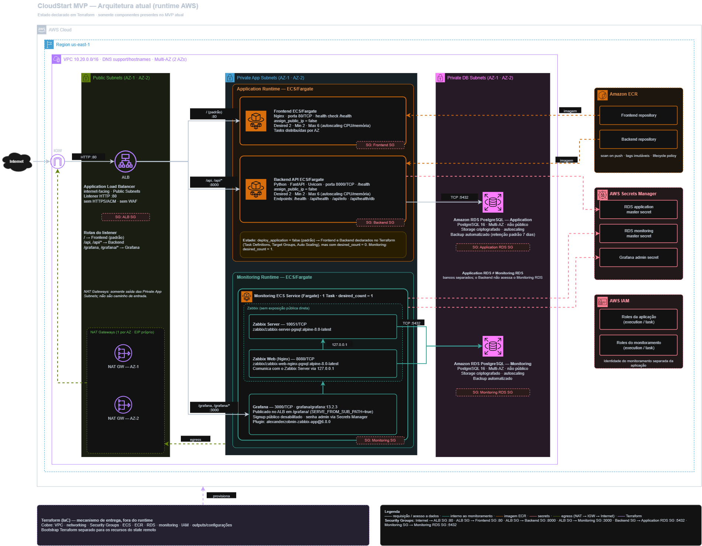

# NOVA / CloudStart

[](https://developer.hashicorp.com/terraform)
[](https://aws.amazon.com/)
[](https://github.com/joao-henrike/NOVA/actions/workflows/ci.yml)

Infraestrutura como código para uma aplicação web na AWS: frontend, backend FastAPI, PostgreSQL, ECS/Fargate, rede privada, observabilidade Zabbix/Grafana e comandos operacionais para validar, implantar, pausar, retomar e destruir o ambiente de desenvolvimento.

> **Referência operacional para este ciclo: branch `TESTE1`.** O guia único para AWS CloudShell é **[TESTE1 — deploy, shutdown, resume e destruição](docs/TESTE1-DEPLOY-TEARDOWN.md)**. Este README é apenas a entrada rápida; os documentos técnicos detalham os componentes. O README anterior foi [arquivado para consulta histórica](docs/archive/README-JOAO-HISTORICO.md) — **não execute seus comandos antigos**.

> **Validação:** a CI comprova testes e verificações estáticas, **não** que a infraestrutura completa já tenha sido criada, testada, desligada e destruída com sucesso numa conta AWS. A primeira execução real deve ser registrada no [runbook](docs/TESTE1-DEPLOY-TEARDOWN.md).

## 1. Branches e limites de execução

| Referência | Uso correto |
| --- | --- |
| `TESTE1` | **Branch operacional deste ciclo**. `make deploy`, `make doctor` e NOVA Ops (`shutdown`/`resume`). |
| `Joao` | Base histórica e branch autorizada para os workflows GitHub de CD/OIDC no ambiente `development`. `make deploy` local também a aceita. |
| `main` | Branch estável histórica; **não** é o ponto de partida recomendado para este ciclo. |

**Atenção:** aceitar `TESTE1` no script local não libera a branch no GitHub Environment `development`. Não contorne as regras de confiança OIDC nem misture os procedimentos locais com o deploy via GitHub Actions.

## 2. Arquitetura resumida

| Camada | Componentes declarados |
| --- | --- |
| Rede | VPC, sub-redes públicas e privadas em duas AZs, Internet Gateway e NAT Gateways. |
| Acesso web | ALB público para frontend, API e Grafana; HTTPS exige certificado ACM e DNS configurados à parte. |
| Aplicação | Imagens frontend/backend no ECR, serviços ECS Fargate, escalonamento e health checks. |
| Banco de dados | RDS PostgreSQL da aplicação e da monitoração, privados, com credenciais gerenciadas. |
| Observabilidade | Zabbix e Grafana em ECS, RDS próprio e logs no CloudWatch. |
| Estado e segredos | State remoto no S3, Secrets Manager e controles de conta/região. |



> O diagrama é mantido no repositório. Em caso de divergência, prevalecem o Terraform e o [documento de arquitetura](docs/architecture.md).

## 3. Começar na AWS CloudShell — validação antes de criar recursos

Pré-requisitos: permissão AWS autorizada para a conta indicada em `config/dev.env`, AWS CLI, Git, `make`, `jq`, `curl`, `unzip`, Python **3.12+**, Docker com daemon/Buildx/Compose funcional e espaço em disco suficiente para compilar e publicar duas imagens. O `make setup` prepara ferramentas do projeto, mas não instala todos esses pré-requisitos de sistema.

```bash
git clone --branch TESTE1 --single-branch https://github.com/joao-henrike/NOVA.git
cd NOVA

git status --short --branch
aws sts get-caller-identity
docker info
df -h "$HOME" /tmp

make setup
make doctor
make validate
make tf-validate
make test-deployment-contracts
make ops-test
```

Esses testes não executam `terraform apply` nem criam infraestrutura. **Se o `doctor`, Docker ou a validação falhar, resolva antes do deploy.** A disponibilidade do Docker e do armazenamento depende do ambiente CloudShell.

### Implantar o ambiente completo (cria recursos cobrados)

```bash
make deploy
```

O script verifica branch/conta e state, provisiona segredos, aplica a infraestrutura base, publica imagens no ECR, prepara roles e migrações PostgreSQL, ativa ECS e executa verificações de saúde. Pode deixar recursos cobrados se uma etapa posterior falhar; **não há rollback universal automático**.

## 4. Operação, pausa e retomada

```bash
make ops ACTION=overview
make ops ACTION=services
make ops ACTION=costs
make ops ACTION=logs ARGS='backend --since 2h'

# Pausa reversível (requer confirmação):
make ops ACTION=shutdown

# Voltar a operar (requer confirmação):
make ops ACTION=resume
```

O desligamento preserva VPC, bancos RDS, segredos, imagens e state; reduz custos interrompendo workloads/RDS e removendo NAT/ALB via plano protegido. **Não é custo zero**: snapshots, storage, ECR, CloudWatch, S3 e segredos podem continuar sendo cobrados. Uma instância RDS parada pode reiniciar automaticamente após sete dias.

## 5. Destruição controlada (irreversível para a infraestrutura)

```bash
# Inventário sem excluir:
make inventory-cloud

# Cria/verifica snapshots RDS antes de destruir:
make destroy-all

# Opcional: também agenda exclusão de 3 secrets com recuperação de 7 dias:
make destroy-all-with-secrets
```

**Nunca utilize `terraform destroy` diretamente como procedimento de limpeza do NOVA.** Isso pula a etapa de snapshot da aplicação. O script usa confirmação exata de conta/região, estados Terraform conhecidos, relatórios de resultado e inventário pós-limpeza. O bucket S3 do state e os snapshots manuais RDS **são preservados**; os três secrets externos também são preservados, exceto quando a opção explícita de exclusão for confirmada.

Não há garantia de que toda a conta AWS esteja vazia após o teardown: recursos não registrados em estados conhecidos são auditados, não apagados arbitrariamente.

## 6. Desenvolvimento local (não é deploy da AWS)

```bash
make start           # setup + doctor + validação + Docker Compose local
make test            # backend + PostgreSQL local
make smoke           # endpoints locais
make down
```

## 7. Documentação por assunto

| Precisa de... | Referência |
| --- | --- |
| **Executar na CloudShell, implantar, pausar e destruir** | **[Runbook TESTE1 (único procedimento operacional)](docs/TESTE1-DEPLOY-TEARDOWN.md)** |
| Navegar pelo projeto | [Índice completo](docs/README.md) |
| Entender arquitetura e recursos AWS | [Arquitetura](docs/architecture.md) |
| Consultar parâmetros e estados | [Referência de configuração](docs/configuration-reference.md) |
| Detalhes dos passos de Terraform/ECR/ECS | [Deploy — referência técnica](docs/deployment.md) |
| Comandos, custos, logs e limites do NOVA Ops | [Operações](docs/operations.md) |
| Preparar host/CloudShell | [Bootstrap local](docs/local-development.md) |
| GitHub Actions, OIDC e permissões | [CI/CD](docs/ci-cd.md) |
| Estado comprovado e pendências | [Inventário de implementação](docs/current-state.md) |
| Segurança e riscos conhecidos | [Segurança](docs/security.md) / [Exceções](docs/security-exceptions.md) |
| Utilitários shell | [Scripts](scripts/README.md) |
| Código e serviços | [Backend](apps/backend/README.md) · [Frontend](apps/frontend/README.md) · [Monitoramento](monitoring/README.md) · [Bootstrap](bootstrap/README.md) |

**Princípio KISS:** uma branch operacional (`TESTE1`), um runbook, comandos reprodutíveis e verificações que falham com segurança. Sempre consulte o plano e os resultados antes de executar comandos que cobram ou removem recursos.
